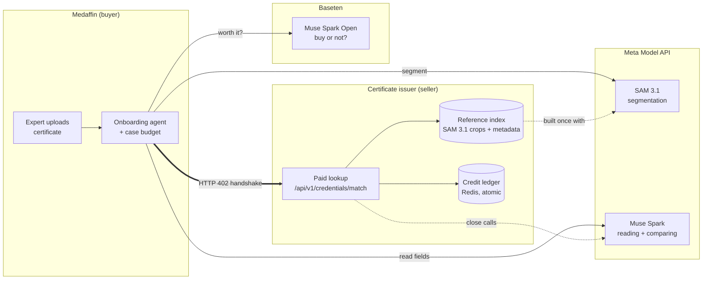
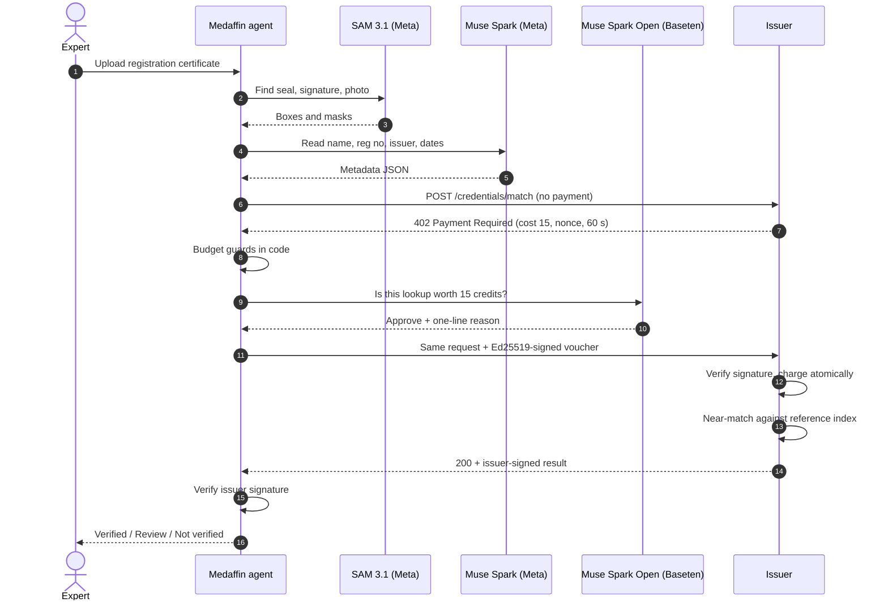
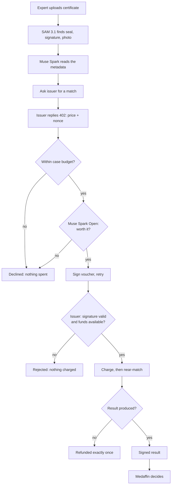
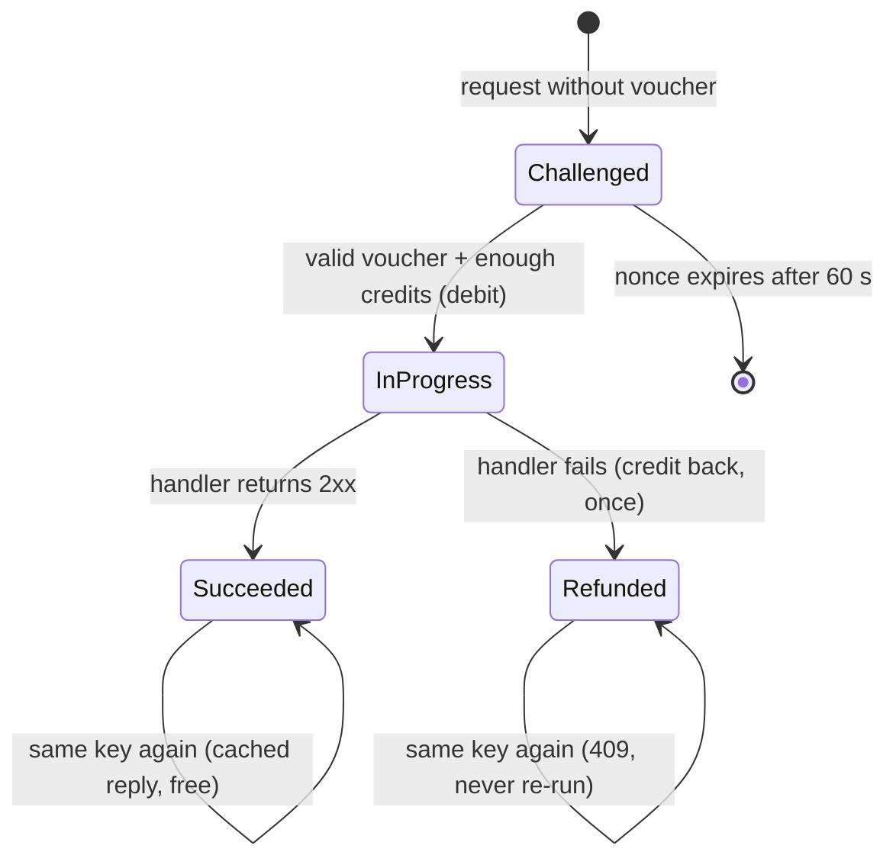
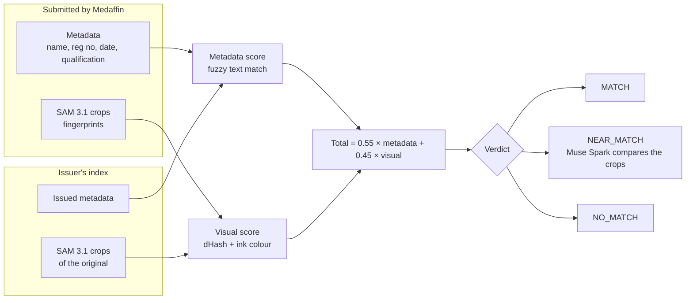
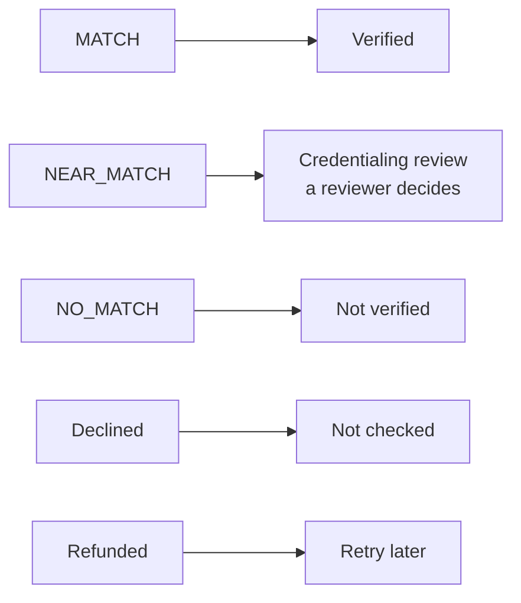

# Mudrika (मुद्रिका)

**Signed credits for autonomous agents.**

In Sanskrit, a *mudrika* is a signet ring. It's the seal a king pressed on an order to approve a payment, and the seal that proved a document was genuine. Mudrika does both jobs for AI agents:

1. **Pay.** An agent buys a service over HTTP using prepaid credits, within a budget it can't exceed, and signs every purchase.
2. **Prove.** The service it buys here is credential verification: SAM 3.1 checks whether a doctor's certificate matches the one the issuer actually issued.

> Built for the **Meta AI Developer Hackathon** (Oct 26 – Nov 4, 2026), theme *Build for Your World*.
> Models: **SAM 3.1** and **Muse Spark** via Meta Model API, **Muse Spark Open** via Baseten. *Built with Muse Spark Open.*
> Open source under the MIT licence.

**Live demo:** https://mudrika-medaffin.onrender.com (access code in the hackathon submission). The issuer node is a machine-to-machine API that the dashboard calls server-side; you never need to open it.

---

## Contents

1. [The problem in one minute](#1-the-problem-in-one-minute)
2. [The idea](#2-the-idea)
3. [System map](#3-system-map)
4. [One onboarding case, step by step](#4-one-onboarding-case-step-by-step)
5. [How the payment works](#5-how-the-payment-works)
6. [How the match works](#6-how-the-match-works)
7. [From verdict to decision](#7-from-verdict-to-decision)
8. [Try the demo](#8-try-the-demo)
9. [Run it yourself](#9-run-it-yourself)
10. [Use the protocol in your own API](#10-use-the-protocol-in-your-own-api)
11. [Security and secrets](#11-security-and-secrets)
12. [Honest scope](#12-honest-scope)
13. [Repo layout](#13-repo-layout)
14. [What was built during the hackathon](#14-what-was-built-during-the-hackathon)

---

## 1. The problem in one minute

Medaffin is a professional network for healthcare experts. Before anyone joins, someone has to confirm they're really registered. Today that means:

- someone **emails a medical council** and waits days for a reply,
- someone **compares a scanned certificate by eye**,
- the council does this work **for free**, so it has no reason to answer quickly,
- and nobody keeps an **audit trail** of who checked what, or when.

## 2. The idea

The issuer (a medical council or university) runs a small paid service. Medaffin's onboarding agent buys one lookup per applicant, automatically, within a budget it sets.

| | Without Mudrika | With Mudrika |
|---|---|---|
| Who checks | A person, by email | An agent, over HTTP |
| How long | Days | Seconds |
| What the issuer gets | Nothing | Paid per lookup |
| What leaves Medaffin | The whole certificate | Only cropped regions + extracted text |
| Proof | An email reply | A result signed by the issuer |
| Spending control | None | Per-case budget, enforced in code |

## 3. System map



**Medaffin** uses Meta's models to understand the certificate, then pays the issuer to compare it with the original record.
**The issuer** segmented every certificate it issued once with SAM 3.1, so it can compare like with like.

## 4. One onboarding case, step by step

Numbered version (who talks to whom, in order):



Unnumbered version (the same logic as a flow):



## 5. How the payment works

Each lookup is one **operation**. The issuer's ledger moves it through a small state machine inside a single Redis Lua script, so no two requests can race.



What this guarantees:

| Guarantee | How |
|---|---|
| The price can't be changed in transit | The voucher signs method, path, body hash, cost, nonce, agent, seller |
| No double charge | Nonce check, balance check and debit happen in one atomic script |
| No negative balance | Balance is checked and debited in the same script |
| Retries are safe | Same idempotency key replays the cached result for free |
| Refunds happen once | Only the `InProgress → Refunded` transition credits back |
| The model can't overspend | Budget guards run in code before Muse Spark Open is asked; a failed or malformed answer means "decline" |

Full protocol reference: [docs/PROTOCOL.md](docs/PROTOCOL.md).

## 6. How the match works



| Verdict | Rule |
|---|---|
| `MATCH` | total ≥ 0.85, metadata ≥ 0.90, visual ≥ 0.75, **and every compared region (seal, signature, photo) ≥ 0.75** |
| `NEAR_MATCH` | total ≥ 0.65 **and** metadata ≥ 0.70: close to a real record but not identical. (Every certificate a council issues carries the same seal, so the seal alone never lifts a case.) |
| `NO_MATCH` | anything lower |

## 7. From verdict to decision



Mudrika never makes the final call on a borderline case. `NEAR_MATCH` always goes to a credentialing reviewer, with the issuer's evidence attached.

## 8. Try the demo

Open **https://mudrika-medaffin.onrender.com**, enter the demo access code (in the hackathon submission), pick a certificate and press **Run onboarding case**. No code? Run it locally in offline mode ([section 9](#9-run-it-yourself)). It needs no keys.

| Try this | What you'll see |
|---|---|
| **Genuine certificate** (a rescanned copy) | `MATCH` → **Verified** |
| **Altered certificate** (real name and number, wrong seal and signature) | Close to a real record → **Credentialing review** |
| **Unknown registrant** | `NO_MATCH` → **Not verified** |
| Set the **budget to 10** | The agent declines before signing. Nothing is spent |
| Tick **Simulate issuer outage** | Charged, then **refunded exactly once** |

The timeline shows every step: SAM's boxes on the certificate, the metadata Muse read, the 402 challenge, Muse Spark Open's reasoning, the voucher, the charge and the issuer's signed result. All certificates, councils and people are fictional.

## 9. Run it yourself

You need Python 3.10+ and Redis (`redis-server`, or `docker run -p 6379:6379 redis:7`).

```bash
git clone https://github.com/RamanthArupa/mudrika && cd mudrika
pip install -r requirements.txt
cp .env.example .env           # fill in keys, or leave them for offline mode
```

**Option A: full run with models** (Meta Model API key + Baseten key)

```bash
set -a; source .env; set +a
uvicorn credentials.issuer_app:app --port 8000 &
uvicorn credentials.medaffin_app:app --port 8001
# open http://localhost:8001 (wait ~1 min for the issuer to index: http://localhost:8000/status)
```

**Option B: offline run, no keys needed.** The whole protocol (402, budget, signed voucher, atomic charge, refund) runs for real. Only the model calls are replaced:
- SAM regions come from the certificate template, labelled `layout`
- metadata comes from the sample's known fields
- the buy decision is a fixed rule, labelled `offline rule`

```bash
export MUDRIKA_OFFLINE=1 MUDRIKA_ADMIN_TOKEN=local-admin ISSUER_URL=http://localhost:8000
uvicorn credentials.issuer_app:app --port 8000 &
uvicorn credentials.medaffin_app:app --port 8001
# open http://localhost:8001
```

If a Meta key is set but no Baseten key, the buy decision uses the same labelled offline rule, so the payment never stalls.

**Tests:** `pytest`. The protocol tests need Redis on `localhost:6379`. The matching tests run offline.

### Deploy your own copy on Render

[](https://render.com/deploy?repo=https://github.com/RamanthArupa/mudrika)

1. Click the button. Render reads [`render.yaml`](render.yaml) and creates the issuer, the Medaffin agent and a persistent Key Value ledger (all on the Starter plan, about $24/month).
2. When prompted, paste your `META_API_KEY` (both services) and `BASETEN_API_KEY` (Medaffin only). The admin token and signing seeds are generated for you.
3. For `ISSUER_URL`, enter the issuer's public URL. If you don't know it yet, use a placeholder, then set it once the issuer is live.
4. Wait about 2 minutes after the issuer starts: it segments its certificates with SAM 3.1 before it accepts lookups (`/status` shows `ready`).
5. Open the Medaffin service URL and run a case.

The Key Value ledger must be a paid plan with persistence. The free tier is in-memory and loses every agent's credits on restart.

To redeploy after a code change, push to `main`. If your Render account isn't linked to GitHub, click **Manual Deploy → Deploy latest commit** on each service.

## 10. Use the protocol in your own API

**Seller:** put a price on any FastAPI endpoint.

```python
from mudrika import MudrikaLedger
from mudrika.server import MudrikaRouter, mudrika

router = MudrikaRouter(ledger=ledger, seller_id="my-seller")

@router.post("/api/v1/thing")
@mudrika(cost=15, capability="my-capability")
async def thing(body: ThingRequest):
    ...  # credits already deducted; raising an error refunds them exactly once
```

**Buyer:** give an agent a budget and an optional decision model.

```python
from mudrika import MudrikaClient

client = MudrikaClient(agent_id="agent-01", secret_key_hex=SECRET, base_url=SELLER_URL,
                       budget=40, per_call_max=25, decider=my_decider)
result = await client.post("/api/v1/thing", json_body={...})
print(result.trace)   # challenge → decision → signed_retry → settled
```

## 11. Security and secrets

- **No API keys are in this repository.** Meta and Baseten keys are read from environment variables (`META_API_KEY`, `BASETEN_API_KEY`) that are set as secrets on the host. [`.env.example`](.env.example) lists every variable with placeholder values; your real `.env` is git-ignored.
- The admin token and the signing seeds are also host secrets. They are never committed.
- Agent and issuer keys are Ed25519. The issuer publishes its public key at `/.well-known/mudrika`.
- Admin routes (register agents, top up credits) fail closed: they stay disabled until `MUDRIKA_ADMIN_TOKEN` is set.
- Only crops and extracted text leave Medaffin. The full certificate image stays with the buyer.
- **The public demo is protected against credit abuse.** Every case spends real Meta and Baseten credits, so the hosted dashboard:
  - requires an access code (`DEMO_ACCESS_CODE`, shared with judges privately, never in this repo)
  - rate-limits each IP address (15 cases an hour) and caps total use (300 cases a day)
  - limits uploads to 4 MB
  - caches SAM 3.1 and Muse results for the sample certificates, so repeat demos cost a single decision call
- **Only registered agents can buy lookups.** The issuer's paid endpoint accepts only agents registered with the admin token. A random caller gets a 402 and has no registered key to sign with. The issuer caches its SAM 3.1 index, so restarts don't re-spend credits.
- **Local runs need no access code.** Leave `DEMO_ACCESS_CODE` unset.

## 12. Honest scope

- **The issuer is simulated.** "Demo Medical Council" and its certificates are fictional. A real council would run `credentials/issuer_app.py` against its own records.
- **What SAM 3.1 finds today.** On the synthetic certificates, SAM 3.1 reliably finds the **seal**, on both the issuer and the buyer side. It doesn't yet detect the drawn signature and photo, so the issuer indexes those regions from its own template, and the buyer matches them on metadata alone. Real scanned certificates, and better prompts, are the next step.
- **Credits aren't money.** They're prepaid authorisation. A real payment rail (cards, x402, MPP) could top up the ledger later.
- **A match is a signal, not a legal ruling.** Borderline cases always go to a person.

## 13. Repo layout

```
mudrika/              the protocol library
  canonical.py        canonical voucher JSON + Ed25519 sign/verify
  ledger.py           Redis Lua scripts: atomic charge, finalize-or-refund
  server.py           @mudrika decorator + MudrikaRouter for FastAPI
  client.py           MudrikaClient: budget guards, 402 negotiation, traces
credentials/          the reference service
  meta_client.py      SAM 3.1 + Muse Spark (Meta) and Muse Spark Open (Baseten) over httpx
  segment.py          seal / signature / photo regions via SAM 3.1
  vision.py           crops + fingerprints (dHash, ink colour)
  matching.py         metadata + visual near-match, verdict rules
  issuer_app.py       seller node: reference index, paid match endpoint, signed results
  medaffin_app.py     buyer agent + dashboard API
  static/index.html   the dashboard
  certs.py            fictional certificates for the demo
tests/                protocol tests (Redis) + matching tests (offline)
docs/                 protocol reference, proposed async extension
render.yaml           Render blueprint: two web services + Key Value ledger
```

## 14. What was built during the hackathon

- The 402 protocol core (handshake, ledger, client) existed before as an earlier prototype, `pay402`. This week it was renamed and extended into **Mudrika**:
  - the decision model's reasoning is now kept on approval
  - admin top-ups
  - packaging and the MIT licence
- **New this week:**
  - the whole `credentials/` service
  - SAM 3.1 on both buyer and issuer
  - Muse Spark metadata extraction and crop comparison
  - Muse Spark Open purchase decisions on Baseten
  - fingerprint near-matching and issuer-signed results
  - the dashboard
  - the Render deployment
  - offline tests

## Licence

MIT © 2026 Arupa AI Private Limited
